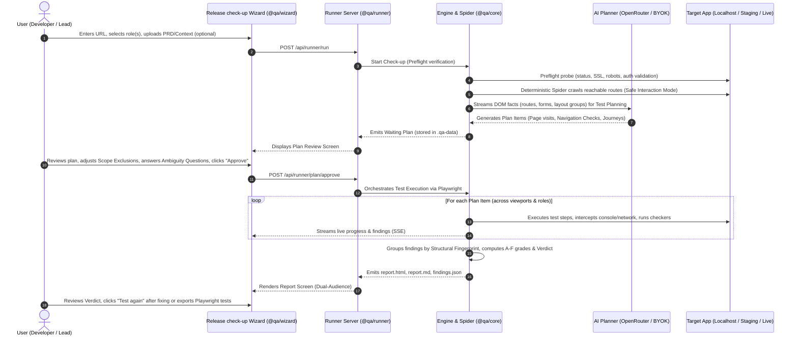
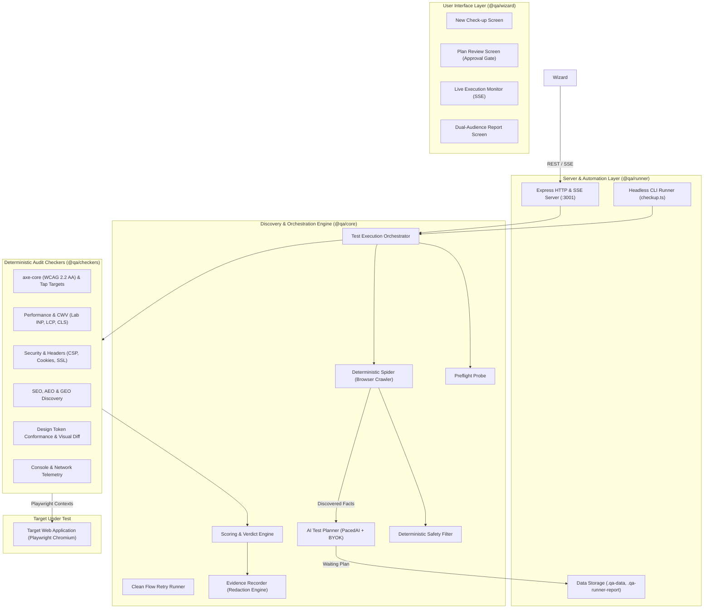
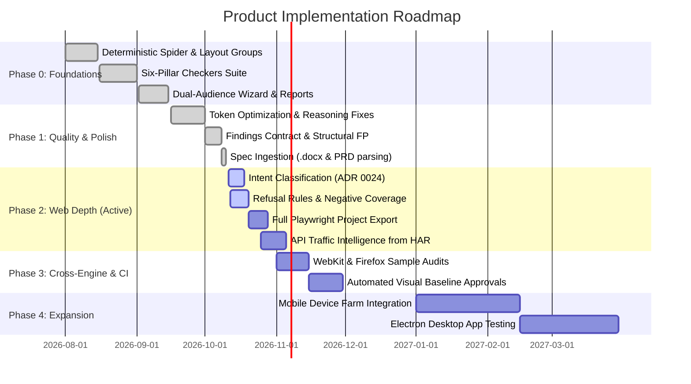

# Product Requirements Document (PRD)

**Product Name:** QA Flow Tester / Pre-Release Readiness Checker (Release check-up)  
**Document Version:** 1.0.0  
**Status:** Approved / Active Baseline  
**Target Release:** Monorepo v0.1.0+ (`qa-flow-tester`)  
**Primary Repository:** [CJCreator/qa-flow-tester](https://github.com/CJCreator/qa-flow-tester)  
**Related Documents:** [PRODUCT_GUIDE.md](file:///c:/Users/HP/OneDrive/Desktop/Projects/AntiGravity%20-%20Google%20-%20Projects/QA%20Tool/docs/PRODUCT_GUIDE.md), [ARCHITECTURE.md](file:///c:/Users/HP/OneDrive/Desktop/Projects/AntiGravity%20-%20Google%20-%20Projects/QA%20Tool/docs/ARCHITECTURE.md), [CONTEXT.md](file:///c:/Users/HP/OneDrive/Desktop/Projects/AntiGravity%20-%20Google%20-%20Projects/QA%20Tool/CONTEXT.md), [PRODUCT_REVIEW.md](file:///c:/Users/HP/OneDrive/Desktop/Projects/AntiGravity%20-%20Google%20-%20Projects/QA%20Tool/PRODUCT_REVIEW.md), [GAP_ANALYSIS.md](file:///c:/Users/HP/OneDrive/Desktop/Projects/AntiGravity%20-%20Google%20-%20Projects/QA%20Tool/docs/GAP_ANALYSIS.md), [ADR Index](file:///c:/Users/HP/OneDrive/Desktop/Projects/AntiGravity%20-%20Google%20-%20Projects/QA%20Tool/docs/adr/)

---

## 1. Executive Summary & Vision

### 1.1 Problem Statement
Modern web software development moves fast, but the final release mile remains chronically broken for small-to-midsize teams without dedicated QA staff. Teams face a crippling trilemma:
1. **Manual testing is slow, superficial, and inconsistent:** Founders and developers manually click through happy paths, frequently missing mobile viewport breaks, accessibility (WCAG) non-compliance, hidden runtime exceptions (500s / console errors), and edge-case journeys.
2. **Scripted end-to-end automation (Playwright/Cypress) is expensive and fragile:** Writing test scripts requires substantial upfront engineering effort. Selector drift and dynamic DOMs turn test suites into high-maintenance liabilities that degrade into flaky failures.
3. **Existing tools lack unified communication and deterministic judgment:** Generic tools dump impenetrable terminal logs or fragmented scores (e.g. Lighthouse), while emergent "autonomous AI agents" attempt to drive browsers unpredictably, hallucinating steps, leaking private data, or triggering unwanted mutations on production systems.

### 1.2 Product Vision & Value Proposition
**QA Flow Tester** (surfaced to users as **Release check-up**) is an automated web application discovery, interactive flow testing, and deterministic pre-release evaluation platform.

The core promise: **Paste a URL (or connect a preview deployment in CI) -> get a complete, reviewable test plan -> execute comprehensive audits with real Playwright browser automation -> receive an unambiguous release verdict ("Ready to release" or "Not ready yet") with zero vendor lock-in.**

Key differentiators:
- **Facts Before AI (ADRs 0009 & 0011):** The browser is never driven blindly by an LLM. A deterministic rule-based spider gathers concrete DOM facts and navigation routes. The AI is consulted *only* to synthesize journeys and test plans.
- **Deterministic Evaluation:** The AI never judges pass or fail. Scoring, letter grades (A–F), and release verdicts are computed deterministically from concrete rule violations and structural findings. Optional AI visual feedback operates purely as non-graded advisory commentary.
- **Strict Safety Model (ADRs 0003, 0014, 0022):** Production sites are strictly read-only (mutations blocked). Interactive state mutations and form testing are restricted to verified **Test Copies**.
- **Dual-Audience User Experience (ADR 0010):** Plain-language summaries, problem groups, and release gates for business leadership on top; instant Playwright repro snippets, console logs, and DOM snapshots collapsible underneath for engineers.
- **Zero Lock-In ("The Exit Door"):** Instant standalone Playwright repro files (`repro-<finding>.ts`) and "Copy Playwright test" snippets are provided for every defect today; full multi-role end-to-end test suite project export (`npx playwright test` workspace) is in active Phase 2 delivery.

---

## 2. Target Personas & Core Use Cases

### 2.1 User Personas

| Persona | Role & Context | Primary Needs & Pain Points | How QA Flow Tester Solves It |
| :--- | :--- | :--- | :--- |
| **P1: Startup Founder / Release Lead** | Non-technical or semi-technical owner approving product launches. | Needs confidence that a release won't embarrass the company or break for users. Hates technical jargon and uncertain risk assessments. | Unambiguous verdict (**Ready to release** vs **Not ready yet**), A–F area grades, plain-English "What to improve first" ranked list. |
| **P2: Full-Stack / Frontend Developer** | Engineer pushing PRs and shipping features rapidly. | Needs exact reproductions, failing selectors, network logs, and fast fix verification without writing hundreds of manual E2E test files. | One-click **Test again** fix verification, instant Playwright test repro generator, collapsible "Details for developers" under each finding. |
| **P3: QA Automation Engineer** | Quality specialist maintaining regression stability. | Needs deterministic, scalable test plans, coverage of negative/boundary cases, and CI/CD integration without flaky test maintenance. | AI-planned journeys grouped into **Layout Groups**, structured Intent classification (**Works**, **Rejects**, **Limits**, **Denied**), and Playwright code exports. |
| **P4: Product Manager / Designer** | Stakeholder managing product requirements and UX quality. | Needs proof that released features conform to product specifications, design tokens, and WCAG accessibility standards. | Product Context document ingestion (.docx/Markdown PRDs), design token conformance audits, and automated WCAG 2.2 AA audits. |

### 2.2 Key User Workflows



---

## 3. Product Principles & Architecture Constraints

The system adheres strictly to the architectural constraints established across project ADRs:

1. **Facts Before AI (ADRs 0001, 0009, 0011):** The browser is never controlled by open-loop LLM prompts. A deterministic rule-based browser crawler discovers DOM nodes, links, and forms. The AI is queried only for planning test scenarios and expectations based on those facts.
2. **Deterministic Quality & Scoring (ADR 0009):** AI never evaluates pass or fail. Deterministic checkers evaluate test assertions, HTTP codes, console logs, design token deviations, and WCAG rules.
3. **Unified Single Application (ADR 0010):** There is no separate "Studio" and "Report Viewer". One integrated application provides high-level business verdicts on top with granular technical evidence disclosed on demand.
4. **Structural Invariance (ADR 0004):** Issues are grouped and deduplicated across runs using an invariant **Structural Fingerprint** (`ruleCode:normalizedRoute:targetElementSelector`), insulating test records from dynamic timestamps or volatile ports.
5. **Deterministic Safety Filter (ADR 0003, 0014, 0022):** Form submissions and state mutations are blocked on live sites. Destructive keywords (e.g. Delete, Pay, Send Email) trigger safety pauses or require explicit confirmation.
6. **Zero Lock-In & Open Artifacts (ADR 0017):** Test plans, results, and findings are exported as standardized JSON Schema (`findings.schema.json`), Markdown (`report.md`, `fix-these.md`), and native Playwright test repros. Full multi-role test suite project export (`npx playwright test` workspace) is in active delivery in Phase 2.

---

## 4. System Architecture & Component Topology

The repository is structured as a TypeScript/pnpm monorepo (Node.js 22, strict mode, ESM):

```
qa-flow-tester/
├── packages/
│   ├── types/      # Shared domain models, plan schemas, verdict logic, fingerprints (browser-safe)
│   ├── checkers/   # Deterministic audit suites (A11y, Performance, Security, SEO, Design Tokens)
│   ├── core/       # Crawl spider, AI planner, test orchestrator, scoring engine, evidence recorder
│   ├── runner/     # Express HTTP + SSE server (port 3001), CLI checkup runner, session storage
│   └── wizard/     # React + Vite frontend ("Release check-up", dual-audience UI)
├── fixtures/       # Built-in target applications for automated benchmarking (Invoicing app)
└── docs/           # ADRs, API specs, architectural diagrams, research roadmaps
```

### Component Architecture Diagram



---

## 5. Detailed Functional Requirements

### 5.1 Discovery Engine & Deterministic Spider
- **FR-1.1 Crawl Boundary:** Crawl internal links starting from the designated origin up to a configurable page limit (default 200 in Wizard; default 50 in CI). Never follow external hosts outside the Domain Allowlist.
- **FR-1.2 Layout Grouping:** Compute DOM structural fingerprints for discovered pages. Group template-driven routes (e.g. `/products/1`, `/products/2`) into a single **Layout Group**.
- **FR-1.3 Sample Page Efficiency:** Select up to 3 **Sample Pages** per Layout Group for exhaustive testing; verify remaining pages in the group for basic navigational reachability.
- **FR-1.4 Interactive State Reachability:** Discover interactive states behind UI triggers (dropdowns, tabs, accordions, modals) using Safe Interaction Mode. Record the sequence of opening steps.
- **FR-1.5 Safe Interaction Mode:** On live sites or non-test hosts, strictly abort mutating HTTP methods (`POST`, `PUT`, `PATCH`, `DELETE`). Never submit forms during the spider discovery crawl.
- **FR-1.6 Target Mode Gating for Test Plans:** When the target is not a verified Test Copy (e.g. live production URL):
  - The spider operates strictly in Read-Only mode.
  - The AI Planner generates `Rejects` items (safe validation checks that do not mutate state), but marks all mutating `Works` and `Limits` items (form submissions, record mutations/deletions) as Disabled (Scope Exclusion: "Requires Test Copy Consent").
  - Mutating steps cannot be toggled on until the domain is verified or localhost/tunnel environment is confirmed (§6.1).
- **FR-1.7 Crawl Concurrency, Throttling & Bot Bypass:**
  - Configurable crawler worker concurrency (default 2 workers, capped to prevent host resource exhaustion).
  - Configurable request delay pacing (default 100ms interval between page requests) to prevent triggering anti-bot protections (Cloudflare, AWS WAF, Akamai).
  - Configurable custom User-Agent and bypass request headers (e.g. `X-QA-Bypass-Token`, Cloudflare Access service tokens) injected into all Spider and Playwright navigation contexts.

### 5.2 AI Test Planner & Budgeting (BYOK)
- **FR-2.1 Fact-Grounded Planning:** Convert raw spider facts (routes, inputs, labels, actions) into structured Plan Items. The AI must never invent arbitrary routes or unverified DOM selectors.
- **FR-2.2 Pipelined Discovery & Planning (ADR 0020):** Stream completed page batches to the AI Planner while the spider crawls remaining routes, minimizing idle latency.
- **FR-2.3 Fixed-Rule Fallback (ADR 0009):** If no AI key is configured, or if the model truncates/fails/exhausts quotas, instantly plan tests using deterministic heuristics (form validation attributes, link destination matching).
- **FR-2.4 AI Request Budgeting:** Predict required AI requests prior to crawl start. Track token usage per stage (planning, repair, journeys, visual review). Enforce daily request ceilings.
- **FR-2.5 Ambiguity Questions:** Generate human-facing clarification questions only when encountering ambiguous side-effects (e.g. untracked payment buttons or irreversible administrative actions). Key questions by form layout fingerprint, never repeating questions per page.
- **FR-2.6 Spec Reconciliation & Unreachable Spec Requirements:** When Product Context documents (.docx or Markdown) define features, user flows, or route requirements that the Deterministic Spider cannot discover in the live DOM (e.g. unlinked routes, hidden controls, or unconfigured roles):
  - Classify these items under a dedicated category: **`Not found in app`** (`SPEC_GAP` / `UNREACHABLE_SPEC_ROUTE`).
  - Do not treat them as runtime execution failures or grade penalties.
  - Report them as an explicit audit metric ("N of M documented requirements reached in live app"), providing teams visibility into undocumented flows or dead spec requirements.

### 5.3 Intent-Driven Test Matrix & Refusal Rule (ADR 0024)
All journey and form Plan Items must explicitly specify one of four **Intents**:

| Intent | Definition | Generation Mechanism | Passing Criteria (The Refusal Rule) |
| :--- | :--- | :--- | :--- |
| **`Works`** | The intended happy-path flow with valid inputs. | AI Planner or Product Context. | Navigation succeeds, state changes as expected, no runtime errors. |
| **`Rejects`** | Submission of invalid, empty, or malformed data. | Deterministic fixed rules from input attributes (required, pattern, min/max). | Refusal detected via DOM heuristics (below). Must *not* navigate away, alter URL path, or mutate server state. |
| **`Limits`** | Extreme boundaries (max length, special characters, numerical limits). | AI Planner or explicit Product Context requirements. | Gracefully handled without application crash, layout breakage, or unhandled 500 error. |
| **`Denied`** | Access control validation for restricted roles. | Inferred from permission matrices or dual-role spidering. | Action is hidden, disabled, or returns HTTP 401/403 with appropriate access denial message. |

#### Refusal Rule Heuristics for `Rejects`
A `Rejects` Plan Item passes if and only if:
1. **No State Mutation/Navigation:** The browser did not trigger a redirect/navigation away from the form route, and did not receive a 2xx resource-creation response.
2. **Deterministic Refusal Signals (Any of the following):**
   - **Native Constraint Validation:** HTML5 `:invalid` pseudo-class active on the submitted input.
   - **Accessible State:** Element or container carries `aria-invalid="true"`.
   - **Alert Roles:** New or updated container with `role="alert"` or `aria-live="polite|assertive"` containing visible text.
   - **Visible Error Container:** A `:visible` error message node that appeared or updated its text content *after* submission, distinct from static help text.

### 5.4 Plan Review & Approval Gate
- **FR-4.1 Human-in-the-Loop Sign-Off:** Execution is strictly gated until explicit approval (`POST /api/runner/plan/approve`). Nothing executes without user consent.
- **FR-4.2 Granular Scope Exclusion:** Allow users to toggle individual Plan Items, entire Layout Groups, or specific roles and viewports on or off.
- **FR-4.3 Test Cap Bounds:** Support a configurable Test Cap (default 2,000 tests) to prevent runaway runtimes on large applications. Items past the cap remain visible but disabled.
- **FR-4.4 Responsive Approval Bar:** On desktop and mobile viewports, display total planned test counts, estimated execution duration, and sticky approval actions.
- **FR-4.5 Waiting Plan Persistence:** Persist unapproved plans in `.qa-data/`. Switching to another site must preserve existing waiting plans rather than discarding work.

### 5.5 Test Execution Orchestration & Playwright Automation
- **FR-5.1 Context Isolation:** Execute tests across isolated Playwright `BrowserContext` instances. Never leak cookies, local storage, or cached state between worker runs.
- **FR-5.2 Authentication Bootstrap & Role Contexts:** Support two distinct authentication mechanisms per role:
  1. **Storage State (Recommended):** Ingest pre-authenticated Playwright `storageState.json` (cookies + localStorage). Bypasses SSO, MFA, CAPTCHA, and third-party OAuth providers.
     - *Storage at Rest:* In local mode, `storageState.json` is stored under `.qa-data/auth/` (enforced in `.gitignore`). In hosted/beta mode (`RUNNER_BETA=1`), it resides strictly in ephemeral in-memory storage (tmpfs) and is destroyed immediately when the browser context closes.
  2. **Automated Login Script:** Provide `loginUrl`, `usernameSelector`, `passwordSelector`, and `submitSelector` in project settings. The runner logs in once per worker pool, validates successful redirect, and caches the context storage state.
- **FR-5.3 Clean Flow Retry & Flaky Handling:** On test failure, abort tainted UI state and execute a clean retry in a pristine browser context. If the retry passes, mark the test **Flaky Passed**. A `Flaky Passed` test imposes a small stability penalty (-3 points per occurrence) in the area score (§5.8), but does *not* trigger a hard release-blocking failure unless the score falls below the gate threshold.
- **FR-5.4 Breakpoint Coverage:** Execute audits across standard responsive breakpoints:
  - Mobile: `375px × 667px`
  - Tablet: `768px × 1024px`
  - Desktop: `1440px × 900px`

### 5.6 Six-Pillar Audit Checker Suite

```mermaid
mindmap
  root((Six-Pillar Quality Audit))
    Works
      Unhandled Exceptions & Console Errors
      Failed Network Requests (4xx, 500s)
      Broken Navigation Links & Dead-ends
      Form Submission & Refusal Rules
    Accessible
      axe-core WCAG 2.2 AA Conformance
      Touch Target Sizing (>= 24px WCAG / 44px Optimal)
      Keyboard Focus Traversal & Trap Detection
      Form Control Labels & ARIA Roles
    Fast and Mobile
      Core Web Vitals (Lab INP, Burst CLS, Real LCP)
      Viewport Meta Configuration & Horizontal Overflow
      Resource Budgeting (Page Weight <= 4MB)
    Findable
      Search Engine Meta (Title, Description, Canonical)
      OpenGraph & Twitter Card Metadata
      Structured Data (JSON-LD Schema.org)
      AI Search & Answer Readiness (AEO / GEO)
    Secure
      Content Security Policy (CSP) & CORS Health
      Cookie Security (Secure, HttpOnly, SameSite)
      Subresource Integrity (SRI) & Source Map Exposure
      Sensitive Credential Leak Prevention
    Looks and Reads Well
      Design Token Conformance (Colors, Radii, Typography)
      Perceptual Visual Regression Diffing (pixelmatch)
      Advisory AI Visual Review (Non-Graded Commentary)
```

- **FR-6.1 Works:** Trap all uncaught JavaScript exceptions, console errors (`console.error`), HTTP 4xx/5xx responses, and broken internal/external navigation links.
- **FR-6.2 Accessible:** Run automated WCAG 2.2 AA checks via `axe-core`. Validate touch target sizes (enforcing 24px minimum per WCAG 2.5.8; flagging <44px as optimal design advice).
- **FR-6.3 Fast & Mobile:** Measure real browser Core Web Vitals (Largest Contentful Paint, Cumulative Layout Shift via burst-window calculation, lab Interaction to Next Paint). Flag horizontal viewport overflows.
- **FR-6.4 Findable (SEO, AEO, GEO):** Audit title tags, meta descriptions, canonical links, robots directives, OpenGraph tags, and JSON-LD schema. Note: For internal SaaS apps or localhost test copies, Findable checks are automatically de-emphasized.
- **FR-6.5 Secure:** Audit HTTPS enforcement, mixed content, cookie flags (`Secure`, `HttpOnly`, `SameSite`), CSP headers, and ensure sensitive form fields never expose values in URLs.
- **FR-6.6 Looks & Reads Well:** Audit live `getComputedStyle()` against committed `design-tokens.json` (deterministic pass/fail). Capture perceptual visual diffs across runs via `pixelmatch` (deterministic threshold). Optional AI visual review operates strictly as advisory commentary in developer diagnostics; it never alters numerical scores, area letter grades, or release verdicts.

### 5.7 Grouping, Deduplication & Structural Fingerprinting
- **FR-7.1 Invariant Fingerprint:** Deduplicate run-level findings into canonical problems using `hash(ruleCode + normalizedRoute + selector)`.
- **FR-7.2 Problem Grouping:** Multiple occurrences of the same underlying defect across viewports or sample pages must collapse into one actionable Problem.
- **FR-7.3 Site-Wide Fact Deduplication:** Universal issues (e.g. missing favicon, missing global robots.txt) must be reported exactly once per site, never duplicated per page.

### 5.8 Scoring, Grading & Deterministic Release Verdict
- **FR-8.1 Deterministic Area Scoring Rubric:**
  Each of the 6 areas starts with a baseline score of 100 points:
  - **Blocker defect:** -50 points each (0 tolerance for Grade A or B).
  - **Major defect:** -20 points each.
  - **Minor defect:** -5 points each.
  - **Flaky Passed test:** -3 points each (recorded as an execution stability penalty).

  **Deterministic Area Grade Scale:**
  - **A:** 90–100 (0 Blockers, 0 Majors)
  - **B:** 75–89 (0 Blockers, <= 1 Major)
  - **C:** 60–74 (0 Blockers)
  - **D:** 40–59 (Critical defects present)
  - **F:** < 40 points, OR >= 1 unhandled first-party HTTP 500 (navigation/document request or matching the target application origin/API) / unhandled runtime crash. Non-critical third-party network failures (e.g. tracking pixels, external beacons, third-party analytics) trigger standard Major (-20) or Minor (-5) deductions without triggering an automatic site-wide Grade F.

- **FR-8.2 Gating Rules & Binary Release Verdict:**
  Output an unambiguous binary verdict based on the chosen gate:
  - **Standard Gate (Default):** Ready to release if 0 Blockers AND all 6 areas score >= C (score >= 60).
  - **Strict Gate:** Ready to release if 0 Blockers, 0 Majors, AND all 6 areas achieve Grade A (score >= 90).
  - **Lenient Gate:** Ready to release if 0 Blockers in Works and Security (all other areas advisory).
- **FR-8.3 "What to Improve First" Ranking:** Rank recommendations strictly:
  1. Blocker severity first.
  2. Number of affected pages second.
  3. Implementation effort (S/M/L) third.
  4. Cap each quality area at a maximum of 2 recommendations in the top 5.

### 5.9 Reporting, Developer Diagnostics & Exports
- **FR-9.1 Dual-Audience Presentation:** Renders executive summary and grades on top, with collapsible technical details underneath each problem.
- **FR-9.2 Developer Diagnostics:** Each problem contains:
  - Exact reproduction steps.
  - Failing DOM selector and element HTML snapshot.
  - Browser console stack trace and network request telemetry.
  - **"Copy Playwright test"** button generating standalone reproduction code.
  - **"Copy bug report"** button generating pre-formatted Markdown for issue trackers.
- **FR-9.3 Standalone Artifact Generation:** Output self-contained, offline-viewable artifacts in `.qa-runner-report/runs/<runId>/`:
  - `report.html`: Self-contained interactive report with embedded styles and images.
  - `report.md`: Clean Markdown summary for PR comments or documentation.
  - `findings.json`: Machine-readable findings complying with `docs/findings.schema.json`.
  - `fix-these.md`: Targeted brief formatted for ingestion into AI coding tools.
- **FR-9.4 Test Again (Fix Verification):** Provide a one-click re-run workflow using the previously approved plan to verify that applied fixes resolved the targeted canonical problems.
- **FR-9.4.1 Spec Drift Triage:** When an assertion fails due to copy mismatch or step deviation rather than an application crash:
  1. Surface an inline prompt: "Step N differed from uploaded spec. Is this a bug or an intended update?"
  2. Clicking "Update Spec" updates the compiled test plan step with the new DOM selector/text and stores an override in `.qa-data/spec-overrides.json`, resolving the failure for subsequent runs without editing the source markdown/word document.
- **FR-9.5 Native Playwright Export:**
  - **Single-Finding Repro:** Standalone reproduction scripts (`repro-<finding>.ts`) and "Copy Playwright test" snippets are generated for every detected problem today.
  - **Full Project Export (Phase 2):** Active delivery of modular Playwright test repository exports (`npx playwright test` workspace) with per-role storage states, clean fixtures, and environment-variable-driven authentication.

### 5.10 CI/CD & Headless Operation
- **FR-10.1 One-Shot CLI Runner:** Support running check-ups directly from CI via `pnpm checkup <url>`.
- **FR-10.2 CLI Exit Code Gating & Default Behavior:** Support `--fail-on blocker` and `--fail-on major` CLI flags to enforce automated PR merge gating.
  - **Default CLI Exit Code:** If neither `--fail-on` flag is supplied, the exit code mirrors the Standard Gate: Exit `0` if 0 Blockers AND all 6 quality areas score >= C (score >= 60); Exit `1` otherwise.
- **FR-10.3 GitHub Actions Workflow Integration:** Automatically generate native GitHub Actions workflow files (`qa-check.yml`) providing job summaries and inline PR annotations.

---

## 6. Safety, Security & Data Governance

### 6.1 Test Copy Classification & Mutation Gating
- **Classification Rules:** An application is classified as a **Test Copy** only if:
  1. It runs on `localhost`, `127.0.0.1`, or a private RFC-1918 IP subnet.
  2. It is served through an active development tunnel (e.g. ngrok, cloudflare tunnel).
  3. The domain has been validated as a **Verified Domain** via DNS or file verification.
  4. The user explicitly accepted the Test Copy consent notice (ADR 0022).
- **Enforcement:** On any target not classified as a Test Copy, the execution engine strictly blocks interactive state mutations and form submissions.

### 6.2 SSRF & Host Confinement
- In hosted or shared multi-tenant deployments, the runner resolves target hostnames before requests and strictly prevents Server-Side Request Forgery (SSRF) targeting cloud metadata endpoints (e.g. `169.254.169.254`) or internal network services.

### 6.3 Evidence Redaction (ADR 0016)
- Automatically redact sensitive data before persisting logs or generating artifacts:
  - Passwords, credit card numbers, and authorization headers (`Bearer *`).
  - Session tokens and authentication cookies.
  - User-specified regex patterns.

### 6.4 Ephemeral Session Governance & Auth Storage
- **Local Developer Mode:** User credentials, approved plans, and uploaded authentication storage states (`storageState.json`) are stored locally under `.qa-data/auth/` and strictly protected by `.gitignore`.
- **Shared Beta Mode (`RUNNER_BETA=1`):** API keys, credentials, and uploaded `storageState.json` sessions are held exclusively in ephemeral in-memory storage (tmpfs) for the duration of the run and are purged immediately when the browser context or session terminates.

---

## 7. Non-Functional Requirements (NFRs)

| Category | Requirement Specification | Metric / Target |
| :--- | :--- | :--- |
| **Performance** | Spider discovery crawl speed across static and client-side apps. | <= 60 seconds for 50 pages on local/staging networks. |
| **Execution Speed** | Test plan execution throughput using Playwright workers. | <= 3 minutes for 60 standard tests on modern multi-core machines. |
| **Token Efficiency** | AI Planner prompt and completion token economics. | Average <= 1,000 prompt tokens per page batch; 0 token waste on deterministic link names. |
| **Resource Footprint** | Memory and CPU footprint of runner process during testing. | Operates reliably within 512MB RAM for headless runner; <= 1.5GB during concurrent Playwright execution. |
| **Accessibility** | Self-compliance of the Wizard UI against accessibility standards. | 100% WCAG 2.2 AA conformance; 0 axe violations; tap targets >= 24px (standard) / 44px (primary). |
| **Portability** | Platform independence across operating systems and browsers. | Windows (PowerShell), macOS, and Linux; Chromium, Firefox, and WebKit (Playwright). |
| **Reliability** | Deterministic reproducibility of checkers. | 0% false positives on static checks; flaky rate < 2% with Clean Flow Retry enabled. |

---

## 8. Release Roadmap & Implementation Status



### 8.1 Completed Milestones (Phase 0 & 1)
- [x] Autonomous Deterministic Spider with Layout Group clustering and Sample Page selection.
- [x] AI Test Planner with automatic Fixed-Rule fallback and multi-provider BYOK support (OpenRouter, Claude, OpenAI, Gemini).
- [x] Six-Pillar Audit Suite (Works, Accessible, Fast/Mobile, Findable, Secure, Looks/Reads Well).
- [x] Invariant Structural Fingerprinting and problem deduplication.
- [x] Dual-audience React/Vite Wizard and offline standalone HTML/Markdown/JSON reporting.
- [x] One-shot CI runner (`checkup.ts`) with GitHub Actions job summaries and exit codes.
- [x] Product Context parser supporting Markdown and Microsoft Word (.docx) specifications.

### 8.2 Current Priorities (Phase 2: Web Depth)
- [ ] **Intent-Driven Plan Items (ADR 0024):** Complete implementation of `Works`, `Rejects`, `Limits`, and `Denied` classification.
- [ ] **Deterministic Refusal Rule:** Standardized validation refusal checking (`:invalid`, `aria-invalid`, `role="alert"`).
- [ ] **Native Playwright Suite Export:** Full project export yielding modular, executable TypeScript test repositories.
- [ ] **API Traffic Intelligence:** Passive audit of recorded network calls (JSON drift, unhandled error bodies, slow endpoints).

### 8.3 Future Horizon (Phases 3 & 4)
- [ ] Cross-browser sample passes (WebKit and Firefox Playwright builds).
- [ ] Visual baseline masking for dynamic elements (dates, advertisements).
- [ ] Mobile app discovery and testing via Maestro driver integration.

---

## 9. Success Metrics & Key Performance Indicators (KPIs)

1. **Defect Detection Accuracy:** Planted defect detection rate >= 95% on benchmark fixtures (broken links, unhandled 500s, tap-target violations, console exceptions).
2. **False Positive Rate:** < 2% across standard web applications with Clean Flow Retry enabled.
3. **Time to First Verdict (TTFV):** Initial check-up completion in < 5 minutes for a 50-page web application.
4. **Fix Verification Velocity:** Single-click "Test again" executes in < 30 seconds for targeted problem re-verification.
5. **Zero Test Maintenance Burden:** Teams eliminate dedicated script authoring for pre-release sanity checks while retaining full code ownership via Playwright exports.
