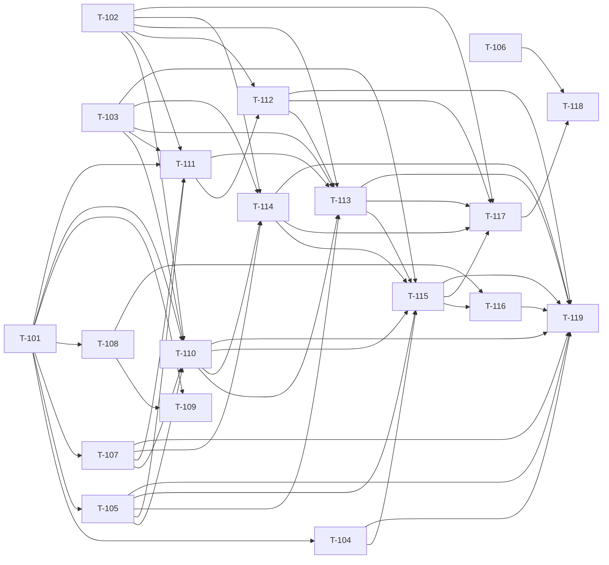

# Board

All tickets start `todo`. Update the Status column when a ticket is picked up (`doing`), built (`built`) or verified (`done`). Source of truth for dependencies: `tickets.json`.

| Wave | Ticket | Title | Size | Depends on | Gaps closed | Status |
|---|---|---|---|---|---|---|
| 0 | T-101 | Shared contracts: route telemetry, sign-in step, input rules, shared coverage type | S | none | G-003, G-006, G-018, G-049 | done |
| 0 | T-102 | Fixture routes that reproduce auth and crawl failure modes | M | none | G-012, G-028 | done |
| 0 | T-103 | Browser context options, origin-scoped headers, narrower browser restart | M | none | G-004, G-016, G-039 | done |
| 0 | T-106 | Tooling alignment: one Playwright version, typecheck tests, Node pin | M | none | G-025, G-026, G-047 | done |
| 1 | T-104 | Runner input validation: roles, login path, header rules | S | T-101 | G-018, G-022, G-023 | todo |
| 1 | T-105 | Redacted debug logger and CLI debug switch | S | T-101 | G-003, G-006, G-018 | todo |
| 1 | T-107 | Shared navigation helper: settle, status, redirects, retry | M | T-101 | G-030, G-001, G-005, G-007, G-008, G-009 | todo |
| 1 | T-108 | Wizard sign-in form: selectors, login URL, header validation, re-approval roles, a11y | M | T-101 | G-017, G-018, G-033, G-013 | todo |
| 2 | T-109 | Wizard: show crawl coverage and crawl health | M | T-101, T-108 | G-019, G-053 | todo |
| 2 | T-110 | Deterministic sign-in (preflight) | L | T-101, T-102, T-103, T-105, T-107 | G-001, G-002, G-003, G-004, G-022, G-023, G-037, G-027 | todo |
| 2 | T-111 | Spider reliability core | L | T-101, T-102, T-103, T-105, T-107 | G-005, G-006, G-007, G-009, G-015, G-021, G-038, G-040, G-027 | todo |
| 3 | T-112 | Spider link discovery and trap protection | M | T-102, T-111 | G-010, G-020, G-031 | todo |
| 3 | T-114 | Orchestrator: reuse sign-in, detect session loss, real status for Permission Matrix | M | T-102, T-103, T-107, T-110 | G-008, G-011, G-014, G-004 | todo |
| 4 | T-113 | Discovery agent: headers everywhere, one sign-in, session-drop reporting, telemetry | M | T-102, T-103, T-105, T-110, T-111, T-112 | G-004, G-014, G-006, G-007, G-010 | todo |
| 5 | T-115 | Runner integration: headers to every stage, reuse sign-in, per-run auth dir, redacted errors | L | T-103, T-104, T-105, T-110, T-113, T-114 | G-004, G-014, G-022, G-036 | todo |
| 6 | T-116 | Persistence integrity and re-approval | M | T-108, T-115 | G-013, G-017, G-024, G-048 | todo |
| 6 | T-117 | End-to-end proof on the fixture | M | T-102, T-112, T-113, T-114, T-115 | G-012, G-028, G-027 | todo |
| 7 | T-118 | CI gates: login+crawl on PRs, nightly wizard-e2e, release and deploy parity | S | T-106, T-117 | G-029, G-025, G-026 | todo |
| 7 | T-119 | Docs and ADR 0026 | M | T-104, T-105, T-107, T-110, T-112, T-113, T-114, T-115, T-116 | G-032 | todo |

## Dependency graph

