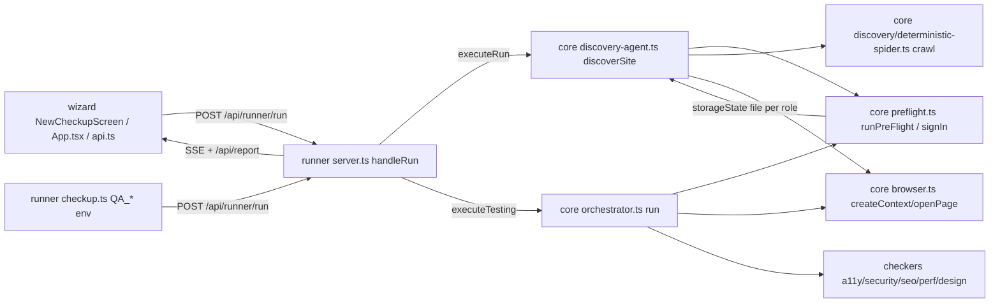

# Context (fresh audit, 2026-10-13)

Source: 5 `repo-explorer` runs over code. Status claims come from code, not docs. Items marked *assumption* were not confirmed by reading the code. Goal scope: authentication flow and crawler/spider reliability. Branch `feat/e2e-url-credentials-crawl`, HEAD `bc14ab3`, working tree clean.

## Purpose
QA Flow Tester ("Release check-up"): self-hosted tool. Scan a web app (Discovery), write a reviewable Plan, run it with Playwright and deterministic checkers (Test run), produce a release report. `README.md`, `CLAUDE.md`.

## Stack
pnpm monorepo, TypeScript, Node 22, vitest, Playwright (Chromium), Vite + React wizard. `package.json`, `pnpm-workspace.yaml`, `vitest.config.ts`, `render.yaml`, `vercel.json`. CI: `.github/workflows/{ci,deploy,benchmark,qa-check,release}.yml`.

## Architecture

## Module map
| Area | Files |
|---|---|
| Login | `packages/core/src/preflight.ts` (`signIn` :151, `runPreFlight` :284, `checkSuppliedSession` :373), `credentials.ts` (placeholders only) |
| Crawl | `packages/core/src/discovery/deterministic-spider.ts` (`crawl` :234), `discovery-agent.ts` (`discoverSite` :244, `describeExploration` :164-226), `element-inventory.ts`, `interactive-states.ts`, `guard.ts`; separate `competitive/safe-crawler.ts` (public read-only scan) |
| Contexts | `packages/core/src/browser.ts` (`createContext` :123, `openPage` :173, `installRequestGuard` :57), `live-site.ts` (`blockChanges` :94) |
| Test run | `packages/core/src/orchestrator.ts` (`run` :338, preflight :370, per-test context :546) |
| Runner API | `packages/runner/src/server.ts` (5116 lines: `handleRun` ~2690, `executeRun` 2923, `executeTesting` 3523, `handleSignInChange` 1666, `handleAddSignIn` 4390), `run-inputs.ts`, `checkup.ts` |
| Wizard | `packages/wizard/src/screens/NewCheckupScreen.tsx`, `lib/form.ts`, `api.ts`, `App.tsx` |
| Types | `packages/types/src/{signin,evidence-finding,discovery,run-report,review-plan}.ts` |
| Fixture | `fixtures/test-app/server.js` (707 lines) |

## Conventions
Typed fixed sign-in failure reasons (`types/src/signin.ts`: wrong-details, no-form, unreachable, needs-more, session-expired); error shape `{error, code}` with `ERR_*`; passwords in memory only unless remembered (OS keychain); silent best-effort `catch {}` is common in the spider; tests beside `packages/*/tests`, per-file throwaway `http.createServer` or the fixture. Project glossary in `CONTEXT.md` (root). Wizard imports single modules from `@qa/types/src/...`.

## Commands
`pnpm build` (types, then checkers/core, then runner); `pnpm test` (`vitest run`); `pnpm exec vitest run <file>`; `pnpm test:url-first`; `pnpm fixture`; `pnpm smoke`. CI runs vitest excluding `wizard-e2e.test.ts`, with coverage and no thresholds (`.github/workflows/ci.yml`). Real-browser tests need Chromium.

## Built / partial / missing (auth + crawl, from code)
Built: single deterministic form login with heuristic selectors, two-step and opener-click; per-role storageState saved to `<authDir>/<role>.json` and passed to role crawls and test contexts; in-memory supplied sessions with host validation (`run-inputs.ts:117-174`); fail-closed `requireSignIn`; `rolesNotTested`; `pageCoverage` in report; anchor + limited script-click crawl; robots on public hosts.
Partial: header propagation (discovery only); login-bounce detection (spider, password-field heuristic); sign-in success check; SPA handling.
Missing (no code found by explorers): hydration/`networkidle` wait in login and spider; cookie/redirect/post-login-selector success verification; login retry; session-expiry detection or re-login mid-crawl or in test run; sitemap; HTTP status capture in spider; query-aware and hash-route dedupe; depth/wall-clock budget; per-route crawl logging; selector overrides in wizard; wizard rendering of `pageCoverage`; SPA/overlay/query-trap fixtures.

## Risks / tech debt
- `server.ts` 5116 lines; heavy churn on server.ts, orchestrator, discovery-agent, spider, browser, preflight.
- Two sign-ins per check-up (discovery preflight at `discovery-agent.ts:263`, then `orchestrator.ts:370`).
- `customHeaders`/`userAgent` not passed to the test run (`server.ts:3548-3582`) or to sign-in contexts (`preflight.ts:333`); headers apply to every origin in the context (assumption: Playwright semantics).
- `orchestrator.ts:903-909` hardcodes `statusCode: 200` into `PermissionMatrixChecker.checkAccess`.
- `AccountPoolManager` (`core/src/account-pool.ts`) appears unused (*assumption*).
- Doc/code mismatches to verify: CLAUDE.md names `URL_FIRST_IMPLEMENTATION_PLAN.md` and `UX_IMPLEMENTATION_PLAN.md`, not in `git ls-files` (per earlier smoke test; re-verify).
- Environment: Windows host, OneDrive path.
