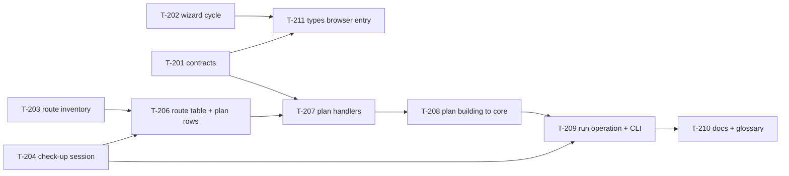

# Board: Check-up Session and runner route table

All tickets start `todo`. Set a ticket `doing` when it is picked up, `built` when its PR is up, `done` when it is
merged and verified. Source of truth for dependencies: [`tickets.json`](tickets.json). Findings and their
dispositions: [`AUDIT.md`](AUDIT.md); the finding-to-ticket mapping, both ways: [`TRACEABILITY.md`](TRACEABILITY.md).
Decision record: [ADR 0027](../../adr/0027-checkup-session-module-and-route-table.md).

| Wave | Ticket | Title                                                                  | Type     | Size | Depends on   | Findings             | Status |
| ---- | ------ | ---------------------------------------------------------------------- | -------- | ---- | ------------ | -------------------- | ------ |
| 0    | T-201  | Check-up API contracts in `@qa/types`                                  | refactor | S    | none         | A-006                | done   |
| 0    | T-202  | Wizard: break the `ScanningScreen` / `coverage-text` cycle             | refactor | S    | none         | A-010                | done   |
| 0    | T-203  | Route inventory test: pin every documented route before the rewrite    | test     | M    | none         | A-001, A-004         | done   |
| 1    | T-204  | Check-up Session: the state and the operations                         | refactor | L    | none         | A-001, A-004         | done   |
| 1    | T-211  | One browser-safe entry into `@qa/types` for the wizard                 | refactor | S    | T-201, T-202 | A-012                | done   |
| 2    | T-206  | Route table, and the plan routes as its first rows                     | refactor | M    | T-204, T-203 | A-001, A-004         | done   |
| 3    | T-207  | Plan handlers become functions over the session                        | refactor | L    | T-206, T-201 | A-002, A-004         | done   |
| 4    | T-208  | Plan building moves to `@qa/core`                                      | refactor | M    | T-207        | A-003                | done   |
| 5    | T-209  | The run operation gets one home; the CLI uses it, without a port       | refactor | L    | T-204, T-208 | A-005                | done   |
| 6    | T-210  | Docs and glossary: the session, the routes, the new way to add a route | docs     | S    | T-209        | — (docs consequence) | done   |

Ticket `T-205` no longer exists: it was merged into `T-204` at the owner's request (the state and the operations it
mutates are one hand-off, landed as two commits). The id is not reused.

Critical path: T-204 → T-206 → T-207 → T-208 → T-209 → T-210. Waves 0 and 1 have parallel tickets; everything from
T-206 on serializes on `packages/runner/src/server.ts`.

## Dependency graph

## File ownership across waves

One owner per wave for each shared file, as in the previous plan:

| File                                            | Wave 1                         | Wave 2 | Wave 3 | Wave 4 | Wave 5 | Wave 6 |
| ----------------------------------------------- | ------------------------------ | ------ | ------ | ------ | ------ | ------ |
| `packages/runner/src/server.ts`                 | T-204                          | T-206  | T-207  | T-208  | T-209  | —      |
| `packages/runner/src/session/*.ts`              | T-204                          | —      | T-207  | —      | T-209  | —      |
| `packages/runner/src/routes/*.ts`               | —                              | T-206  | T-207  | —      | —      | —      |
| `packages/core/src/plan/build.ts`               | —                              | —      | —      | T-208  | —      | —      |
| `packages/runner/src/checkup.ts`                | —                              | —      | —      | —      | T-209  | —      |
| `packages/wizard/**`                            | T-211                          | —      | —      | —      | —      | —      |
| `packages/types/src/browser.ts`                 | T-211                          | —      | —      | —      | —      | —      |
| `docs/**`, `CONTEXT.md`, `CHANGELOG.md`         | —                              | —      | —      | —      | —      | T-210  |
| `packages/types/src/checkup-api.ts`             | T-201 (Wave 0)                 |        |        |        |        |        |
| `packages/wizard/src/api.ts`                    | T-201 (Wave 0), T-211 (Wave 1) |        |        |        |        |        |
| `packages/wizard/src/lib/coverage-text.ts`      | T-202 (Wave 0), T-211 (Wave 1) |        |        |        |        |        |
| `packages/runner/tests/route-inventory.test.ts` | T-203 (Wave 0)                 |        |        |        |        |        |

Files with two wave numbers are edited by two tickets in sequence — never in the same wave.

## Work in flight (2026-10-15, uncommitted)

Waves 0 and 1 are written and **uncommitted on `main`**, on top of the previous session's sign-in/crawl edits:

- `packages/types/src/checkup-api.ts` + `packages/types/tests/checkup-api.test.ts` + the wizard's aliases (T-201),
- `packages/wizard/src/lib/scan-progress.ts` and the imports around it (T-202),
- `packages/runner/tests/route-inventory.test.ts` (T-203),
- `packages/types/src/browser.ts` + `packages/types/tests/browser-entry.test.ts` + the fifteen wizard import paths
  (T-211).

`pnpm build` is green with all of the above. **No test was executed** (the session was told to build only), so
`built` here means "type-checks and builds", not "verified": T-203's 61 pairs, T-211's two non-vacuity proofs and
T-201's contract test still need their own run, and `pnpm typecheck` fails repo-wide on pre-existing errors (176 of
them, mostly wizard tests without import extensions) so it is not a usable gate.

T-204 onward are **not started**. The critical path (T-204 → T-206 → T-207 → T-208 → T-209 → T-210) serializes on
`packages/runner/src/server.ts`, which is 5595 lines and carries ~230 references to the state T-204 moves; each of
those tickets is a large, mostly mechanical move of a single file, and each carries a ready-made agent prompt in its
`## Agent prompt` section for the `/ship` workflow, one ticket per fresh agent.
