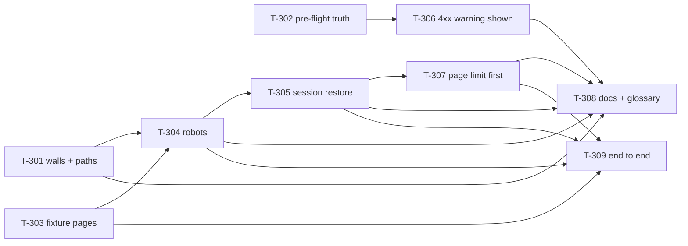

# Board: sign-in and crawling

All tickets start `todo`. Set a ticket `doing` when it is picked up, `built` when its PR is up, `done` when it is
merged and verified. Source of truth for dependencies: [`tickets.json`](tickets.json). Findings and their
dispositions: [`GAPS.md`](GAPS.md); the mapping both ways: [`TRACEABILITY.md`](TRACEABILITY.md). Audited at
`8d41601`, working tree, 2026-10-15 — another session has uncommitted edits in five of the files below, so check
`git diff` before you start a ticket and say in the PR what you found.

| Wave | Ticket | Title                                                               | Type     | Size | Depends on                        | Findings               | Status |
| ---- | ------ | ------------------------------------------------------------------- | -------- | ---- | --------------------------------- | ---------------------- | ------ |
| 0    | T-301  | The spider stops calling ordinary pages sign-in walls               | bug      | M    | none                              | LC-002, LC-009         | done   |
| 0    | T-302  | The pre-flight result stops claiming what it did not check          | bug      | M    | none                              | LC-005, LC-006, LC-007 | done   |
| 0    | T-303  | Fixture App: the pages the login-and-crawl tests need               | test     | S    | none                              | LC-010                 | done   |
| 1    | T-304  | The spider actually honours `robots.txt`                            | security | S    | T-301, T-303                      | LC-001                 | done   |
| 1    | T-306  | A start address that answers 4xx is shown as a warning, not as fine | feature  | S    | T-302                             | LC-007                 | done   |
| 2    | T-305  | One session-restore path, and a recovered route is not dropped      | bug      | M    | T-304                             | LC-003, LC-004         | done   |
| 3    | T-307  | The page limit is checked before a page's work, not after           | refactor | S    | T-305                             | LC-008                 | done   |
| 4    | T-308  | Docs and glossary: sign-in, crawling, and what the reports mean     | docs     | S    | T-301, T-304, T-305, T-306, T-307 | LC-005, LC-006, LC-009 | done   |
| 5    | T-309  | End to end: the fixture App proves the fixes hold together          | test     | M    | T-303, T-304, T-305, T-307        | LC-010                 | done   |

Follow-up on 2026-10-15 (same tree, uncommitted): T-302 now also marks a Role whose own sign-in page does not
answer as `unreachable` (two cases in `preflight-result-truth.test.ts`), and T-309's two remaining scenarios are
written — the politeness note (with the host check stubbed, everything else the shipped code) and a mid-crawl
recovery against a small server of the test's own, since the fixture's `/lab/expire-session` invalidates every
session for good and so could never show a *restored* one. Verified and marked `done` by tester.

Critical path: **T-301 → T-304 → T-305 → T-307 → T-309**. Wave 0 and wave 1 run in parallel; waves 2 and 3 are a
chain on `deterministic-spider.ts`; T-308 waits for the behaviour it describes.

Max parallelism: 3 (wave 0), then 2 (wave 1), then 1 — four tickets share the crawler file, so the crawler is the
bottleneck and the plan is deliberately short rather than wide.

## Dependency graph

## File ownership across waves

One owner per wave for each shared file:

| File                                                  | Wave 0 | Wave 1 | Wave 2 | Wave 3 | Wave 4 | Wave 5 |
| ----------------------------------------------------- | ------ | ------ | ------ | ------ | ------ | ------ |
| `packages/core/src/discovery/deterministic-spider.ts` | T-301  | T-304  | T-305  | T-307  | —      | —      |
| `packages/core/src/preflight.ts`                      | T-302  | —      | —      | —      | —      | —      |
| `packages/types/src/evidence-finding.ts`              | T-302  | —      | —      | —      | —      | —      |
| `packages/core/src/discovery/discovery-agent.ts`      | —      | —      | T-305  | —      | —      | —      |
| `packages/core/src/orchestrator.ts`                   | —      | —      | T-305  | —      | —      | —      |
| `packages/runner/src/server.ts`                       | —      | T-306  | —      | —      | —      | —      |
| `packages/wizard/src/screens/NewCheckupScreen.tsx`    | —      | T-306  | —      | —      | —      | —      |
| `packages/wizard/src/api.ts`                          | —      | T-306  | —      | —      | —      | —      |
| `fixtures/test-app/server.js`                         | T-303  | —      | —      | —      | —      | —      |
| `CONTEXT.md`, `docs/*.md`, `CHANGELOG.md`             | —      | —      | —      | —      | T-308  | —      |
| `packages/core/tests/auth-crawl-e2e.test.ts`          | —      | —      | —      | —      | —      | T-309  |
| `packages/runner/tests/auth-crawl-run.test.ts`        | —      | —      | —      | —      | —      | T-309  |

New test files (`spider-signin-walls.test.ts`, `preflight-result-truth.test.ts`, `spider-robots.test.ts`,
`spider-session-recovery.test.ts`, `spider-page-limit.test.ts`, `preflight-route.test.ts`) are owned by the ticket
that writes them; no two tickets claim the same one.

## Work in flight in the same files

`git status` on 2026-10-15 showed uncommitted edits in `deterministic-spider.ts`, `discovery-agent.ts`,
`preflight.ts`, `site-type.ts`, `test-planner.ts`, `plan/journeys.ts`, `packages/types/src/evidence-finding.ts`,
`packages/wizard/src/components/{StepBar,TopBar}.tsx`, `packages/wizard/src/index.css` and
`packages/wizard/src/screens/{LandingScreen,NewCheckupScreen,ScanningScreen,TestingScreen}.tsx` — another session's
sign-in and crawl work.

- Five of those files are owned by tickets above. **Read them first**: if a finding is already fixed there, say so in
  the PR, close it in [`TRACEABILITY.md`](TRACEABILITY.md), and do not touch the rest.
- Three are out of this plan's scope and belong to that session: `site-type.ts`, `test-planner.ts`,
  `plan/journeys.ts`. No ticket here edits them; T-309 must not assert on the Plan prose they produce.
