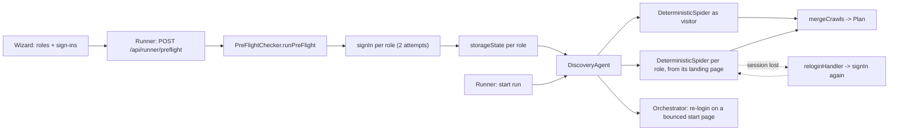

# Context: sign-in and crawling

Read this before the tickets. It says where sign-in and crawling live, what each piece is for, and how to run
things. Every claim has a path (and a line where it helps).

Audited at `8d41601`, against the **working tree**, on 2026-10-15. Another session has uncommitted edits in
`deterministic-spider.ts`, `discovery-agent.ts`, `preflight.ts`, `site-type.ts`, `test-planner.ts`, `journeys.ts`,
`packages/types/src/evidence-finding.ts` and five wizard screens — line numbers below are from that state, so a
shift of a few lines is normal. Re-locate by function name. Finding dispositions are in [`GAPS.md`](GAPS.md).

## What the product does here

A Check-up starts by **signing in** as each Role the person gave, then **crawling** the App: once as a visitor, then
once per Role that signed in, starting from the page that Role landed on. The crawl finds pages, links, buttons and
forms; a Plan is built from what it found; the Plan is executed later. Both steps are deterministic: Playwright plus
fixed rules, **no AI** (`docs/adr/0026-deterministic-sign-in-and-session-handling.md`).

## Login

| Piece                                    | Path                                                                                                                  | Notes                                                                                                                                                      |
| ---------------------------------------- | --------------------------------------------------------------------------------------------------------------------- | ---------------------------------------------------------------------------------------------------------------------------------------------------------- |
| The sign-in itself                       | `packages/core/src/preflight.ts` (777)                                                                                | `PreFlightChecker.checkUrlReachable` :122, `signIn` :214, `runPreFlight` :582, `checkSuppliedSession` :733                                                 |
| Field selectors and the fixed step order | `preflight.ts:38-48`, doc comment :200-210                                                                            | `goto` → `find-fields` → opener? → `username` → `next`? → `password` → `submit` → `post-submit-check`                                                      |
| Origin guards                            | `preflight.ts:77-89` (mixed-host idempotent), `:252-262` (before any request), `:333-343` (after redirects)           | cross-origin `loginPath` is blocked                                                                                                                        |
| Role headers / token / localStorage      | `preflight.ts:264-278`, `:280-307`                                                                                    | token-only sessions are verified without a form                                                                                                            |
| Retry loop, 2 attempts                   | `preflight.ts:314-578`                                                                                                | `SignInResult` carries `attempts`; `SignInFailedError` = `ERR_SIGN_IN_FAILED`                                                                              |
| One failure reason, fixed wording        | `packages/types/src/signin.ts`                                                                                        | `SignInFailureReason` + `signInReasonText`; never page text                                                                                                |
| Credential placeholders                  | `packages/core/src/credentials.ts`                                                                                    | plans and reports hold `{{username}}` / `{{password}}`                                                                                                     |
| Runner routes                            | `packages/runner/src/server.ts`                                                                                       | `POST /api/runner/preflight` (route :1207, handler :1701), test/add a sign-in :1858-1940, `POST /api/runner/plan/add-sign-in` (route :1174, handler :4764) |
| What is kept                             | `server.ts:4126-4195` (`planForDisk`), `:2030-2100` (remembered sign-ins, passwords in the OS keychain)               | roles are written through an allow-list; `username` blanked, no password, no token, no cookies, no header values                                           |
| Wizard                                   | `packages/wizard/src/screens/NewCheckupScreen.tsx` (sign-ins :1128-1206, first sign-in :1294+), `lib/import-roles.ts` | roles as `role,username,password` lines                                                                                                                    |

A second sign-in path exists in the orchestrator, for a session that stops working mid-run:
`packages/core/src/orchestrator.ts:706-770` (`QA_RELOGIN`, `reloginUsed`, `SignInFailedError('session-expired')`).

## Crawling

| Piece                       | Path                                                                         | Notes                                                                                                                                   |
| --------------------------- | ---------------------------------------------------------------------------- | --------------------------------------------------------------------------------------------------------------------------------------- |
| The crawler                 | `packages/core/src/discovery/deterministic-spider.ts` (1120)                 | `crawl` :289, `evaluatePage` :490, `runWorker` :984, queue drain :1055                                                                  |
| Route keys, shapes, traps   | `packages/core/src/discovery/frontier.ts` (170)                              | `normalizeRoute` :26 (lower-cases the path, strips the trailing slash, keeps only `routeQueryParams`), shape caps 25 per shape, depth 8 |
| Who drives it               | `packages/core/src/discovery/discovery-agent.ts` (871)                       | crawl options :426-440, visitor :474-492, one crawl per Role :500-560, notes :199-240                                                   |
| Sign-in walls, session loss | `deterministic-spider.ts:583-630`, note wording `discovery-agent.ts:220-226` | `signInWalls`, `sessionLost`, `skipped[].why: 'sign-in' \| 'session-lost'`                                                              |
| Mid-crawl recovery          | `deterministic-spider.ts:589-605`, handler `discovery-agent.ts:519-536`      | re-signs in and adds the fresh cookies to the live context                                                                              |
| Page loads and telemetry    | `packages/core/src/navigate.ts`                                              | `navigate` (retries, settle, `redirectChain`), `looksLikeLogin` :96, `toTelemetry` :219 (redacts)                                       |
| What counts as one site     | `packages/core/src/same-site.ts`                                             | host, or its `www` twin; ports must match; any other subdomain is another site                                                          |
| robots.txt                  | `packages/core/src/competitive/robots.ts`                                    | `RobotsPolicy.parse` / `.fetch(origin, token)` / `.isAllowed(pathAndQuery)`                                                             |
| Route telemetry types       | `packages/types/src/route-telemetry.ts`                                      | `RouteTelemetry`, `SkippedPageInfo`, `PageCoverage`                                                                                     |

Two switches decide how polite the crawl is (`discovery-agent.ts:426-440`): on a private/loopback host
(`isPrivateHost`) no robots policy is sent and no delay is added; on any other host the crawl honours `robots.txt`
as `CRAWLER_TOKEN` and pauses `PUBLIC_SITE_PAGE_DELAY_MS` between pages. Budgets: `QA_DISCOVERY_MAX_MINUTES`
(default 20), `QA_CRAWL_MAX_MINUTES` (default 10), `maxPages`, per-shape 25, depth 8.



## Built, partial, missing

- **Built and well covered:** the deterministic sign-in (many shapes: two-step, modal, SPA, token-only, wrong
  details, cross-origin, ambiguous), the crawl (links, traps, CRUD, sitemap, concurrency), route telemetry, and the
  redaction of what reaches disk. 23 test files in `packages/core/tests` and 17 in `packages/runner/tests` touch
  this area (`signin*.test.ts`, `spider-*.test.ts`, `auth-crawl-*.test.ts`, `credentials-crawl.test.ts`,
  `signin-endpoint.test.ts`, `remembered-signins.test.ts`, …).
- **Partial:** robots.txt enforcement inside the spider; what happens to a route while a session is being recovered;
  what the person is told about a start address that answers 4xx; the difference between "a role signed in" and
  "no browser was asked" in the pre-flight result.
- **Missing:** a fixture page that has a password field but is not a sign-in page; a disallowed path in the fixture's
  `robots.txt` (it is `Allow: /` today, `fixtures/test-app/server.js:46-51`); any test that hands a `RobotsPolicy`
  to `DeterministicSpider`.

## Conventions to follow

- Glossary terms from the root `CONTEXT.md`: **Deterministic Spider** (never "crawler bot"), **Role**, **Test Copy**,
  **Allowed Hosts**, **Check-up**, **Plan Item**. Respect the `_Avoid_` lists in UI text.
- Fixed wording for a sign-in failure comes from `signInReasonText`; never build a message from page text, and never
  put a password, token, cookie value or header value in a log, a plan file, a report or test output.
- Node-only code stays out of the wizard bundle: the wizard imports single modules from `@qa/types/src/...`.
- `pnpm build` after touching `packages/types` or an exported API. Build order: types, then checkers/core, then
  runner.

## Commands

```bash
pnpm build                                            # type-check rides on it
pnpm exec vitest run packages/core/tests/signin.test.ts     # one file
pnpm exec vitest run packages/core                    # the core suite (needs Chromium for the browser ones)
pnpm exec vitest run packages/runner                  # the runner suite
pnpm fixture                                          # the fixture App the tests crawl
pnpm test:url-first                                   # the focused suite
```

`.claude/work/DEFER_TESTS` does not exist today, so tests run.
